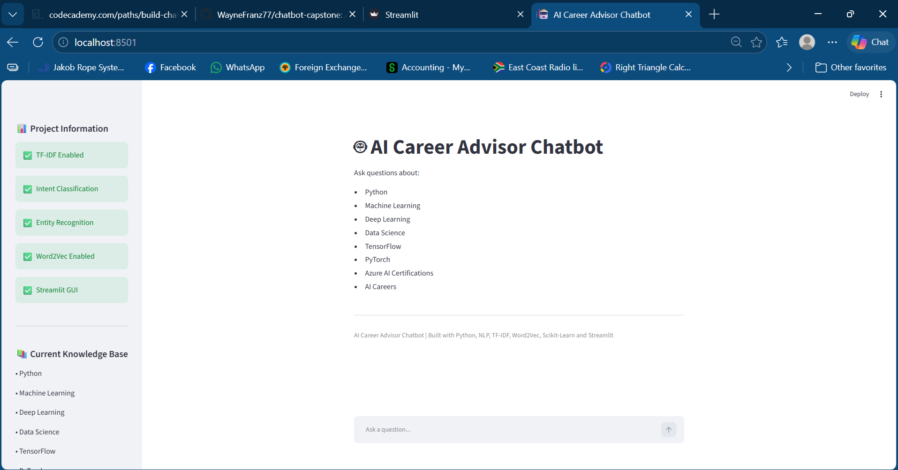
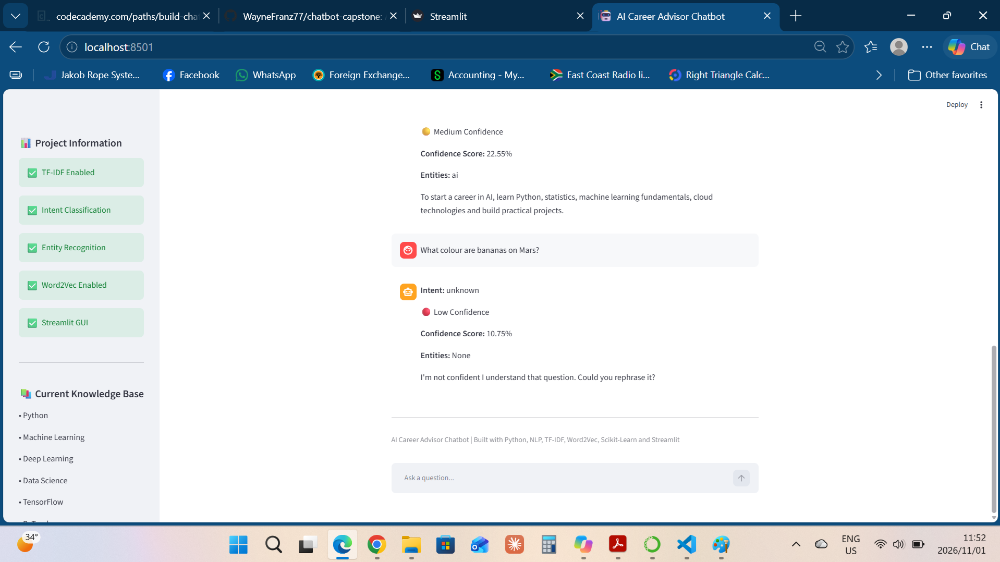
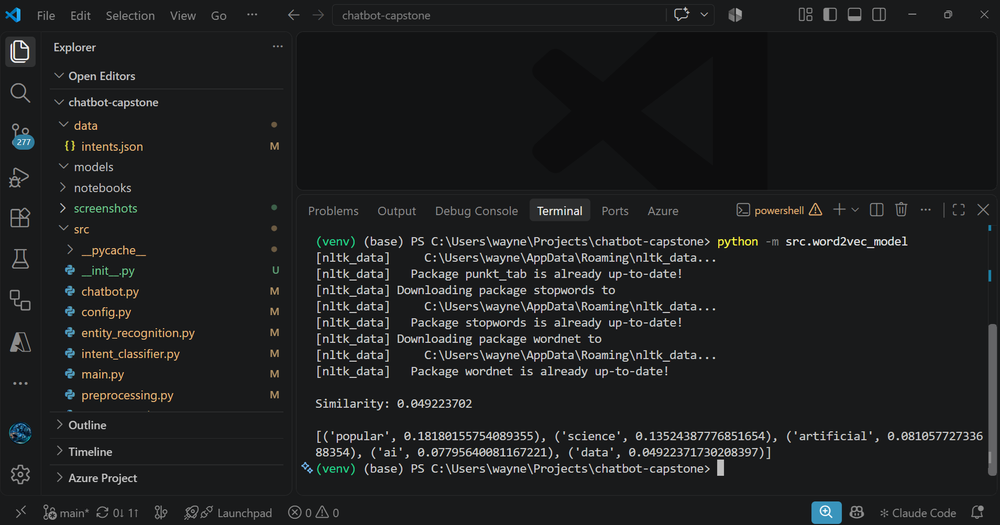
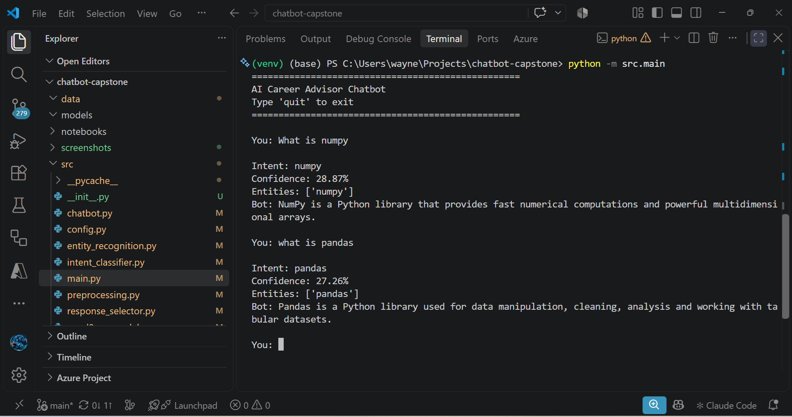

# AI Career Advisor Chatbot

A retrieval-based conversational AI application that helps users explore Artificial Intelligence, Machine Learning, Deep Learning, Data Science, Python programming, Microsoft Azure AI certifications, and AI career pathways.

Built with Python, Natural Language Processing (NLP), Machine Learning, Word Embeddings, and Streamlit.

---

## Project Overview

The AI Career Advisor Chatbot is a closed-domain, retrieval-based chatbot designed to answer questions related to Artificial Intelligence and associated career paths.

Rather than generating responses from scratch, the chatbot processes user input, classifies intent, identifies entities, evaluates confidence, and retrieves the most relevant response from its knowledge base.

The project demonstrates practical implementation of:

- Natural Language Processing (NLP)
- Text Preprocessing
- Machine Learning
- Intent Classification
- Entity Recognition
- Word Embeddings
- Confidence Scoring
- Response Selection
- Streamlit Application Development

This project was developed as a capstone project for Codecademy's Build Chatbots with Python learning path.

---

# Features

## Natural Language Processing

The chatbot preprocesses user input using several NLP techniques:

- Text normalization
- Lowercasing
- Tokenization
- Stopword removal
- Lemmatization

This ensures that user input is cleaned and standardized before further processing.

---

## Intent Classification

The chatbot uses:

- TF-IDF Vectorization
- Logistic Regression

to classify user queries into predefined intents.

Example:

```text
User:
What is Machine Learning?

Intent:
machine_learning
```

Supported intents include:

- Python
- Machine Learning
- Deep Learning
- Data Science
- Statistics
- TensorFlow
- PyTorch
- NumPy
- Pandas
- Azure AI Fundamentals (AI-900)
- Azure AI Engineer Associate (AI-102)
- AI Career Advice
- Chatbot Development

---

## Entity Recognition

The chatbot identifies important entities and concepts within user questions.

Recognized entities include:

- Python
- Machine Learning
- Deep Learning
- Artificial Intelligence
- Data Science
- Statistics
- TensorFlow
- PyTorch
- NumPy
- Pandas
- Azure
- AI-900
- AI-102
- Neural Networks
- Chatbots

Example:

```text
User:
Tell me about TensorFlow and Azure

Entities:
['tensorflow', 'azure']
```

---

## Word2Vec Embeddings

The chatbot includes a Word2Vec model implemented using Gensim.

Word2Vec converts words into numerical vector representations that capture semantic meaning and relationships.

Capabilities include:

- Word similarity calculations
- Semantic relationship analysis
- Related word discovery

Example:

```text
python ↔ data science
ai ↔ machine learning
azure ↔ cloud services
```

---

## Confidence Scoring

The intent classifier provides prediction confidence scores using probability estimates.

Example:

```text
Intent: tensorflow
Confidence: 82.45%
```

Confidence scoring helps evaluate the reliability of predictions.

---

## Low-Confidence Fallback Handling

When confidence falls below a predefined threshold, the chatbot avoids potentially incorrect responses.

Example:

```text
I'm not confident I understand that question.
Could you rephrase it?
```

This improves reliability and user experience.

---

## Streamlit Web Application

The project includes an interactive Streamlit-based graphical user interface.

Features include:

- Conversational chat interface
- Session-based chat history
- Confidence indicators
- Sidebar dashboard
- Knowledge base summary
- Chat reset functionality

---

# Why Retrieval-Based?

A retrieval-based architecture was chosen because it offers:

- Consistent responses
- Reliable outputs
- Explainability
- Faster implementation
- Easier testing and debugging

This approach is particularly suitable for educational and career guidance applications where accuracy is more important than open-ended creativity.

---

# Why Closed-Domain?

The chatbot is intentionally focused on a specific subject area:

- Artificial Intelligence
- Machine Learning
- Deep Learning
- Data Science
- Python Development
- Azure AI Certifications
- AI Career Guidance

Restricting the knowledge domain improves response quality and reduces misinformation.

---

# System Architecture

```text
User Input
    │
    ▼
Text Preprocessing
    │
    ▼
TF-IDF Vectorization
    │
    ▼
Intent Classification
(Logistic Regression)
    │
    ▼
Entity Recognition
    │
    ▼
Word2Vec Semantic Analysis
    │
    ▼
Response Selection
    │
    ▼
Confidence Evaluation
    │
    ▼
Chatbot Response
```

---

# Technology Stack

## Programming Language

- Python 3.12

## Natural Language Processing

- NLTK

## Machine Learning

- Scikit-Learn
- TF-IDF Vectorizer
- Logistic Regression

## Word Embeddings

- Gensim
- Word2Vec

## Data Processing

- NumPy
- Pandas

## User Interface

- Streamlit

---

# Project Structure

```text
chatbot-capstone/
│
├── app.py
├── LICENSE
├── README.md
├── requirements.txt
├── .gitignore
│
├── data/
│   └── intents.json
│
├── screenshots/
│   ├── chatbot_home.png
│   ├── chatbot_python.png
│   ├── chatbot_tensorflow.png
│   ├── chatbot_career_advice.png
│   ├── chatbot_fallback.png
│   ├── cli_chatbot.png
│   └── word2vec_demo.png
│
├── src/
│   ├── __init__.py
│   ├── chatbot.py
│   ├── config.py
│   ├── entity_recognition.py
│   ├── intent_classifier.py
│   ├── main.py
│   ├── preprocessing.py
│   ├── response_selector.py
│   └── word2vec_model.py
│
└── models/
```

---

# Installation

## Clone the Repository

```bash
git clone https://github.com/YOUR_USERNAME/chatbot-capstone.git
```

## Navigate to the Project

```bash
cd chatbot-capstone
```

## Create a Virtual Environment

```bash
python -m venv venv
```

## Activate the Environment

### Windows

```bash
venv\Scripts\activate
```

### Mac/Linux

```bash
source venv/bin/activate
```

## Install Dependencies

```bash
pip install -r requirements.txt
```

---

# Requirements

The project uses the following core libraries:

```text
streamlit
nltk
numpy
pandas
scikit-learn
gensim
scipy
```

Install all required packages with:

```bash
pip install -r requirements.txt
```

---

# Running the Command-Line Chatbot

Run the CLI version:

```bash
python -m src.main
```

Example:

```text
You: What is Machine Learning?

Intent: machine_learning
Confidence: 23.45%
Entities: ['machine learning']

Bot: Machine learning is a branch of AI that enables systems to learn patterns from data.
```

---

# Running the Streamlit Application

Start the web interface:

```bash
streamlit run app.py
```

Open:

```text
http://localhost:8501
```

in your web browser.

---

# Screenshots

## Home Screen



---

## Python Query


---

## TensorFlow Query


---

## AI Career Guidance


---

## Low-Confidence Fallback Handling



---

## Word2Vec Demonstration



---

## Command-Line Interface



---

# Challenges and Solutions

## Python Version Compatibility

The project initially used Python 3.14, which created compatibility issues with Gensim and Word2Vec.

### Solution

The development environment was migrated to Python 3.12, restoring compatibility and enabling successful implementation of Word2Vec.

---

## Import Management

As the project evolved into a multi-file application, managing imports became increasingly challenging.

### Solution

The source directory was converted into a proper Python package using:

```text
src/__init__.py
```

and imports were standardized throughout the project.

---

## Confidence Scoring

Initial confidence values were lower than expected.

### Solution

The dataset was expanded, confidence scoring was retained hat history required persistent session handling.

### Solution

Streamlit Session State was implemented to preserve conversation history across interactions.

---

# Key Learnings

This project strengthened practical skills in:

- Natural Language Processing
- Text Preprocessing
- Intent Classification
- Entity Recognition
- Machine Learning
- Word Embeddings
- Confidence Scoring
- Software Architecture
- Streamlit Application Development
- Python Package Management
- Git and GitHub Workflows

One of the most valuable lessons learned was how multiple machine learning and NLP components work together to form a complete conversational AI system.

---

# Ethical Considerations

Developing conversational AI systems involves several ethical considerations.

## Misinformation

Chatbots may provide incorrect answers when operating outside their intended domain.

Mitigation:

- Closed-domain design
- Confidence thresholds
- Fallback responses

## Bias

Bias in training data can influence chatbot responses.

Mitigation:

- Carefully selected subject matter
- Transparent limitations
- Expandable dataset architecture

## Privacy

Production systems should carefully manage personal information.

Mitigation:

- No user information is stored
- No external data collection
- No user tracking

## Transparency

Users should understand they are interacting with software.

Mitigation:

- Clearly defined scope
- Explicit confidence scores
- Visible fallback handling

---

# Future Enhancements

Potential future improvements include:

- Larger training datasets
- Context-aware conversations
- Advanced entity recognition using spaCy
- Database-backed conversation history
- Azure deployment
- Retrieval-Augmented Generation (RAG)
- Transformer-based embeddings
- Large Language Model integration
- User authentication
- Analytics dashboard

---

# Project Reflection

This project provided an opportunity to combine Natural Language Processing, Machine Learning, Software Engineering, and User Interface Development into a single application.

The development process reinforced the importance of modular design, iterative improvement, testing, debugging, and documentation.

Particular highlights included implementing Word2Vec embeddings, developing confidence-based response handling, and transforming the application from a command-line prototype into an interactive web application using Streamlit.

The completed chatbot demonstrates how multiple AI and NLP techniques can work together to build a practical conversational system and provides a solid foundation for future AI projects.

---

# License

This project is licensed under the MIT License.

See the LICENSE file for additional details.

---

# Author

**Wayne Franz**

AI Engineering Student | Python Developer | Machine Learning Enthusiast

Capstone project developed as part of Codecademy's Build Chatbots with Python learning path.